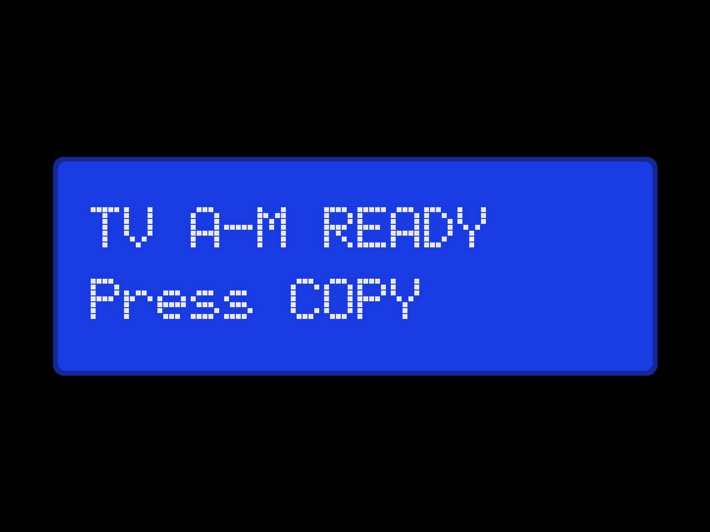
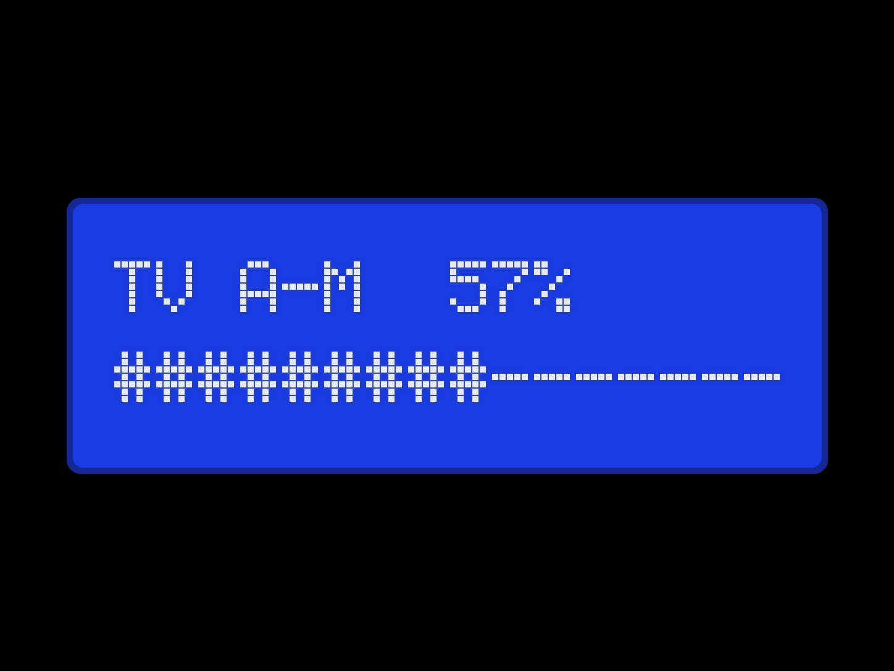
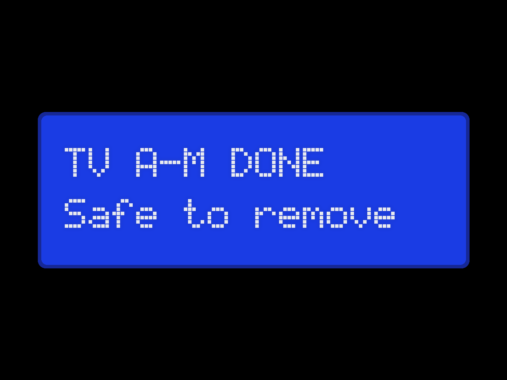

# TruePanel 1.4.0 Release Notes

TruePanel 1.4.0 is the stable release of the 1.4 line. It promotes
1.4.0-rc1 unchanged apart from release metadata and documentation, and it
supersedes 1.3.1-rc1, whose fixes it includes.

## Highlights

- **Loadmaster.** Labelled USB drives stay mirrored with their NAS folders:
  plug in, press Copy, unplug. Verified, resumable copies; nothing on the NAS
  is deleted (replaced files go to `.loadmaster-replaced`); anything ambiguous
  is held for review instead of guessed. Validated on BattleStation with all
  six media drives.
- **Selftest, tones and drive health.** One command checks the setup; the
  PC speaker announces state changes; every plug-in records SMART health and
  free space, and Mission Control forecasts when a drive will fill.
- **Copy-button-only mode.** Mission Control can review and confirm a plan,
  but only the front-panel button starts a sync.
- **Known deployments.** Staging writes a build stamp with the commit and a
  fingerprint of every file; `verify` reports the deployed commit and warns
  about out-of-band edits. `--stage-only` lists exactly what promotion would
  change and smoke-tests the stage.

See the [Changelog](../CHANGELOG.md) for the full list and
[Loadmaster](LOADMASTER.md) for how it works.

## Front panel

While a drive needs attention, the LCD shows Loadmaster screens instead of
its normal rotation:

  
  
  

## Safety boundaries

- Loadmaster is disabled by default and only touches drives whose label
  matches a configured drive and whose UUID it has adopted.
- Loadmaster never deletes from the NAS. Removals from a drive above the
  configured limit need confirmation; protected folders are never changed.
- Deployments still change only through the guarded upgrade, with a retained
  backup and automatic rollback on failed verification.
- No new storage or hardware-control authority beyond Loadmaster's USB
  mounts and the GPIO75 Copy button read.

## Candidate soak

1.4.0-rc1 (`f5c57d3`) was deployed to BattleStation through the guarded
upgrade on 2026-10-27 and ran until promotion:

- `truepanel` and `truepanel-mission-control` stayed active with no
  restarts and no error-level log entries.
- The RC1 gate passed: guarded deployment with `verify` reporting the release
  commit and "files match", `python3 -m truepanel.loadmaster selftest`, and a
  Copy-button sync that recorded drive health with a model name.
- All six media drives completed Copy-button syncs on the same Loadmaster
  code during the candidate's preparation.

## Stable acceptance gate

Before tagging `v1.4.0`:

1. Both canonical version sources report `1.4.0` with no prerelease suffix.
2. The release contract, complete test suite and installed-wheel smoke pass
   in GitHub Actions on the exact release commit.
3. The guarded BattleStation upgrade succeeds, `truepanel version` reports
   `1.4.0`, `verify` reports the release commit and "files match", and both
   services restart and remain active.
4. `python3 -m truepanel.loadmaster selftest` passes on the installed build.

## Rollback

The guarded upgrade keeps the previous deployment as a backup and rolls back
automatically when verification fails. To return to 1.4.0-rc1 by hand,
select the retained pre-upgrade backup and run `truepanel.py upgrade
--rollback --confirm ROLLBACK_TRUEPANEL` as described in
[Upgrading](UPGRADING.md#operator-requested-rollback).

## AEGIS assurance evidence

Existing 1.3.0 AEGIS assurance envelopes remain unchanged and report
`VersionDrift` against 1.4.0, as they did against 1.4.0-rc1. A successor
envelope requires governed requalification and operator review.
